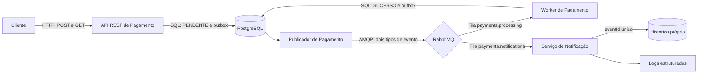

# CompreFácil — processamento distribuído de pagamentos

**[Abrir demonstração HTTPS no navegador](https://probability-vid-calvin-jersey.trycloudflare.com)** · **[Repositório no GitHub](https://github.com/HironNovais/CompreFacil)**

O endereço público usa um túnel gratuito temporário: pode mudar se o conector reiniciar e não tem garantia de disponibilidade. O acesso direto à porta 8088 da VPS foi fechado. Detalhes e recuperação do link em [docs/vps.md](docs/vps.md).

## 1. Apresentação

Implementação acadêmica do Desafio 2 da disciplina Desenvolvimento de Sistemas Distribuídos, do curso de Análise e Desenvolvimento de Sistemas do SENAI. A CompreFácil é um e-commerce fictício que separa pagamentos e notificações para que cada serviço possa executar independentemente.

O projeto executa o fluxo completo em dois microsserviços JavaScript/Node.js: registra uma transação, publica eventos reais via AMQP, simula a confirmação e registra os avisos. Toda cobrança é simulada; não há gateway financeiro.

**Interface no navegador:** depois de iniciar o Compose, abra **http://localhost:8088**. A tela permite criar pagamentos, acompanhar os quatro passos, consultar o histórico e inspecionar os dois avisos reais. A instalação em VPS usa um Compose separado; consulte [docs/vps.md](docs/vps.md).

## 2. Objetivo

Demonstrar comunicação REST, mensageria assíncrona, persistência, consistência entre banco e eventos, consumo idempotente e recuperação de falhas. A resposta HTTP não espera a conclusão do pagamento nem as notificações.

## 3. Tecnologias utilizadas

| Tecnologia | Função |
|---|---|
| JavaScript / Node.js 24 LTS | Runtime de ambos os serviços e testes nativos `node:test` |
| Express 5 | APIs REST independentes |
| PostgreSQL 17 / `pg` | Pagamentos e outbox transacional, com SQL parametrizado |
| RabbitMQ 4.2 / `amqplib` | AMQP 0-9-1, exchange, filas duráveis e confirmações |
| SQLite / `node:sqlite` | Histórico e idempotência em disco, exclusivos de Notificação |
| Nginx / HTML / CSS / JavaScript | Interface responsiva e proxy HTTP para as APIs |
| Docker Compose | Cinco contêineres, rede, volumes, health checks e reinicialização |
| Supertest | Testes HTTP das aplicações Express |
| Git / GitHub Actions | Preparação para versionamento e validação remota |

As versões exatas dos pacotes estão nos `package-lock.json`. Não é necessário instalar Node, PostgreSQL ou RabbitMQ no host para executar tudo pelo Docker. Node 24 no host é necessário para rodar os testes e scripts locais.

## 4. Arquitetura

- **Pagamento**: API REST, repositório PostgreSQL, publicador da outbox e worker AMQP de confirmação simulada, em um processo independente.
- **Notificação**: consumidor AMQP, avisos em logs estruturados, histórico SQLite com `eventId` único e API de saúde/consulta. Não usa o banco nem a API do outro serviço.
- **PostgreSQL**: mantém `payments` e `outbox`, gravados atomicamente para evitar pagamentos sem evento.
- **RabbitMQ**: distribui cada solicitação a uma fila de processamento e outra de notificações; a confirmação vai para Notificação.
- **Interface web/Nginx**: serve a tela de demonstração e encaminha requisições do navegador às duas APIs na mesma origem. A comunicação de negócio entre os dois serviços Node.js continua sendo AMQP.

Decisões, tratamento de erros e limites estão em [docs/arquitetura.md](docs/arquitetura.md).

## 5. Diagrama arquitetural



## 6. Estrutura do projeto

```text
.
├── payment-service/
│   ├── src/{config,messaging,repositories,services,workers}/
│   ├── src/{app.js,server.js,logger.js}
│   ├── tests/api.test.js
│   ├── Dockerfile
│   ├── .env.example
│   └── package.json + package-lock.json
├── notification-service/
│   ├── src/{messaging,services}/
│   ├── src/{app.js,server.js,logger.js}
│   ├── tests/notifications.test.js
│   ├── Dockerfile
│   ├── .env.example
│   └── package.json + package-lock.json
├── database/init.sql
├── web/{public/,tests/,Dockerfile,nginx.conf}
├── deploy/{vps-compose.yml,tunnel-compose.yml,install-vps.sh,.env.vps.example}
├── tests/{integration.test.js,failures.test.js,helpers.js}
├── scripts/
├── requests/{payments.http,payment.json}
├── docs/{arquitetura.md,testes.md,avaliacao.md,github.md,evidencias/}
├── .github/workflows/ci.yml
├── docker-compose.yml
├── .env.example
└── package.json + package-lock.json
```

Cada microsserviço pode ser construído usando somente sua própria pasta. Não há pacote de aplicação compartilhado nem acesso ao código do outro serviço em runtime.

## 7. Pré-requisitos

- Docker Desktop iniciado, com contêineres Linux no Windows; ou Docker Engine e plugin Compose em Linux.
- Acesso à internet no primeiro build para baixar imagens e pacotes.
- Portas locais livres, conforme tabela abaixo. Ajuste `.env` em caso de conflito.
- Opcional para desenvolvimento/testes: Node.js **24.x**, npm e Git; VS Code com REST Client para o arquivo `.http`.

| Componente | Acesso no host | Acesso entre contêineres |
|---|---|---|
| Interface | `http://localhost:8088` | `web:80` |
| Pagamento | `http://localhost:3000` | `payment-service:3000` |
| Notificação | `http://localhost:3001` | `notification-service:3001` |
| PostgreSQL | `localhost:55432` | `postgres:5432` |
| RabbitMQ AMQP | `localhost:5672` | `rabbitmq:5672` |
| Painel RabbitMQ | `http://localhost:15672` | `rabbitmq:15672` |

As portas são publicadas apenas em loopback. A porta externa 55432 evita conflito com um PostgreSQL já instalado em 5432. O contêiner continua usando 5432 internamente.

## 8. Instalação e execução

Na raiz desta pasta, com Docker iniciado:

```bash
docker compose up --build -d
docker compose ps
docker compose logs -f payment-service notification-service
```

Aguarde os cinco contêineres aparecerem como `healthy` e abra **http://localhost:8088** no Chrome. Clique em **Criar pagamento**; a tela consulta os estados reais e atualiza automaticamente. O primeiro build pode demorar. `Ctrl+C` para sair da visualização de logs mantém os serviços executando. Para esperar a prontidão automaticamente:

```bash
docker compose up --build --wait --wait-timeout 120
```

O Compose já possui valores de demonstração e funciona sem `.env`. Para personalizar, copie `.env.example` para `.env` **antes** de iniciar:

```powershell
# PowerShell
Copy-Item .env.example .env
```

```bash
# Bash / Linux
cp .env.example .env
```

Usuário padrão de PostgreSQL e RabbitMQ: `compre_facil`; senha de demonstração: `local_academic_password`. São valores fictícios para execução local. Credenciais reais não devem ser colocadas no repositório. Alterar usuário/senha de bootstrap no `.env` não altera automaticamente credenciais em volumes já inicializados.

Para parar mantendo dados:

```bash
docker compose down
```

Não use `down -v` para uma parada normal: esse comando **apaga os volumes**, incluindo pagamentos, filas e idempotência. A persistência depende de manter esses volumes.

Para desenvolver executando Node no host, inicie somente a infraestrutura e pare eventuais contêineres das APIs que ocupem as mesmas portas:

```bash
docker compose stop web payment-service notification-service
docker compose up -d postgres rabbitmq
npm run setup
```

Copie o `.env.example` de cada microsserviço para `.env` na mesma pasta. No primeiro terminal aberto na raiz, execute `cd payment-service` e `npm start`; no segundo, `cd notification-service` e `npm start`. Os exemplos locais apontam para `localhost:55432` e `localhost:5672`; no Compose os serviços usam nomes de DNS internos. Nesse modo de desenvolvimento use as APIs diretas nas portas 3000/3001; a interface integrada é executada com o Compose completo.

## 9. Endpoints da API

| Serviço / método | Rota | Respostas principais |
|---|---|---|
| Pagamento `POST` | `/payments` | 202 com `id`, `PENDENTE` e mensagem; 400 inválido; 503 indisponível |
| Pagamento `GET` | `/payments/:id` | 200 dados; 400 UUID inválido; 404 inexistente |
| Pagamento `GET` | `/payments?page=1&limit=20` | 200 com `data`, `page`, `limit`; limite máximo 100 |
| Pagamento `GET` | `/health` | 200 pronto; 503 dependência indisponível |
| Notificação `GET` | `/health` | 200 pronto; 503 AMQP/armazenamento indisponível |
| Notificação `GET` | `/notifications?paymentId=UUID` | 200 histórico durável, até 100 registros; filtro opcional |

Requisição:

```json
{"customerName":"Cliente Teste","customerEmail":"cliente@exemplo.com","amount":150.00,"currency":"BRL"}
```

`customerName` é obrigatório (até 120 caracteres), `customerEmail` precisa ser válido (até 254), `amount` deve ser um número positivo até 9999999999.99 com no máximo duas casas e `currency` deve ser `BRL`. JSON tem limite de 16 KB; excesso retorna 413. Paginação inválida retorna 400.

Resposta 202, com cabeçalho `Location: /payments/<id>`:

```json
{"id":"uuid-gerado","status":"PENDENTE","message":"Pagamento recebido para processamento"}
```

Uma consulta posterior retorna `id`, `customerName`, `customerEmail`, `amount`, `currency`, `status`, `createdAt` e `updatedAt`. `amount` é uma **string decimal** (`"150.00"`) para preservar a representação monetária retornada pelo PostgreSQL. O estado pode mudar antes da primeira consulta; a resposta do POST sempre informa o estado inicial aceito.

## 10. Fluxo de processamento

1. Cliente envia POST; validação rejeita dados incorretos sem inserir transação.
2. Uma transação SQL registra pagamento `PENDENTE` e evento na outbox.
3. O POST responde 202 sem aguardar broker, confirmação ou notificação.
4. O publicador envia `SOLICITACAO_RECEBIDA` com publisher confirm; RabbitMQ entrega uma cópia para cada fila apropriada.
5. Notificação grava o aviso de recebimento e imprime o log.
6. O worker de Pagamento simula a aprovação, grava `SUCESSO` e evento de confirmação atomicamente.
7. O publicador envia `PAGAMENTO_CONFIRMADO` e a Notificação grava/imprime o segundo aviso.

As etapas dos consumidores executam de forma independente: a confirmação do pagamento não espera o aviso ser consumido. Isso permite que Notificação fique temporariamente parada sem impedir a aprovação.

## 11. Comunicação assíncrona

Exchange topic `payments.events`; filas `payments.processing` e `payments.notifications`, todas duráveis. A solicitação é roteada às duas; a confirmação somente à Notificação. Cada evento possui UUID próprio, UUID do pagamento, tipo, estado e instante UTC.

Mensagens persistentes, publisher confirms e ack manual reduzem perda por reinício. Redelivery é esperado: o worker impede outra transição e a Notificação usa `eventId` único em SQLite persistente. Mensagens inválidas ou que esgotaram três retries seguem para a fila correspondente com sufixo `.dead`. Entrega é pelo menos uma vez; não se promete exatamente uma vez para rede ou logs.

## 12. Como testar

Para a demonstração visual, abra **http://localhost:8088**, crie um pagamento e acompanhe os passos. O histórico permite selecionar transações anteriores; **Ver os eventos recebidos** mostra os avisos persistidos, incluindo os identificadores. A tela diferencia serviço degradado de componente não verificado e não reenvia automaticamente um POST cuja resposta falhou. O gateway permite 10 POSTs por minuto por IP, com burst de 3.

Para testar diretamente a API, abra [requests/payments.http](requests/payments.http) no REST Client ou use estes comandos na raiz.

PowerShell:

```powershell
$payload = Get-Content -Raw -Encoding UTF8 requests/payment.json
$payment = Invoke-RestMethod http://localhost:3000/payments -Method Post -ContentType 'application/json; charset=utf-8' -Body $payload
$payment
Invoke-RestMethod "http://localhost:3000/payments/$($payment.id)"
Start-Sleep -Seconds 2
Invoke-RestMethod "http://localhost:3000/payments/$($payment.id)"
Invoke-RestMethod "http://localhost:3001/notifications?paymentId=$($payment.id)"
Invoke-RestMethod 'http://localhost:3000/payments?page=1&limit=10'
```

cURL (Bash; no PowerShell, use `curl.exe`):

```bash
curl -i -X POST http://localhost:3000/payments -H "Content-Type: application/json" --data-binary @requests/payment.json
curl http://localhost:3000/payments/COLE-O-ID-RETORNADO
curl "http://localhost:3000/payments?page=1&limit=10"
curl http://localhost:3000/health
curl http://localhost:3001/health
```

Para os testes automatizados, com Node 24 no host:

```bash
npm run setup
npm run check
npm test
# Ambiente Compose iniciado, com o PROCESSING_DELAY_MS padrão:
npm run test:integration
npm run test:failures
# Testes da interface em Chromium desktop e mobile:
npm ci
npx playwright install chromium
npm run test:ui
```

A suíte de falhas **interrompe e reinicia os serviços deste Compose** e deve ser executada separadamente, sem testes ou demonstrações concorrentes. As suítes de integração criam pagamentos de teste e deixam mensagens inválidas nas filas `.dead` como evidência. Não apagam os dados. Consulte [docs/testes.md](docs/testes.md) para resultados executados e [docs/avaliacao.md](docs/avaliacao.md) para o roteiro de apresentação.

## 13. Tolerância a falhas

Para demonstrar independência:

```bash
docker compose stop notification-service
```

Crie outro pagamento e consulte-o: ele chega a `SUCESSO`. No painel RabbitMQ, a fila `payments.notifications` acumula dois eventos. Depois:

```bash
docker compose start notification-service
docker compose logs --tail 30 notification-service
```

Os eventos pendentes são consumidos e aparecem no histórico de notificações. O teste automatizado também verifica recuperação de broker, banco, morte do processo de Pagamento e deduplicação após recriação de contêineres.

Se RabbitMQ cair, PostgreSQL continua aceitando pagamentos na outbox e a saúde fica degradada até reconectar. Se PostgreSQL cair, a API de pagamentos retorna 503; Notificação continua disponível. Retentativas de processamento são limitadas e os erros são registrados.

## 14. Resultados

O build dos cinco contêineres e o fluxo real `PENDENTE → SUCESSO` foram executados neste workspace Windows com Docker Desktop e contêineres Linux. Publicação/consumo, idempotência, transações SQL, mensagens de erro e uso da interface em Chromium desktop/mobile foram verificados. Os relatórios dos 44 testes de backend e dos 10 testes de navegador estão em [docs/testes.md](docs/testes.md).

A publicação da demonstração na VPS é documentada separadamente em [docs/vps.md](docs/vps.md). O repositório para entrega é [HironNovais/CompreFacil](https://github.com/HironNovais/CompreFacil). O resultado da validação remota pode ser consultado na [aba Actions](https://github.com/HironNovais/CompreFacil/actions); os relatórios incluídos nesta versão comprovam as execuções locais e na VPS, sem antecipar o resultado do CI. [docs/github.md](docs/github.md) explica a entrega do link no AVA.

## 15. Conclusão

A aplicação concretiza os dois serviços exigidos pelo desafio, com comunicação REST e AMQP, persistência de pagamentos, processamento independente da requisição e recuperação demonstrável após falhas. Outbox e idempotência persistente tratam duplicações e a fronteira entre banco e broker sem depender de tarefas em memória. As limitações de produção e escalabilidade estão explicitadas na documentação de arquitetura.
