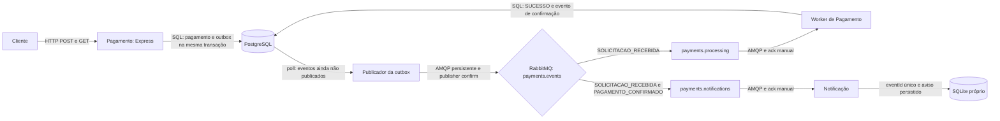

# Arquitetura e decisões

## Responsabilidades e protocolos

O Pagamento é uma aplicação Node.js/Express independente, com seu próprio pacote, imagem, processo e conexão PostgreSQL. A API recebe solicitações por HTTP; o worker e o publicador da outbox executam no mesmo processo, fora do ciclo de vida da requisição. Notificação é outra aplicação Express com seu próprio pacote, imagem, processo e armazenamento. Nenhuma chamada HTTP entre os microsserviços participa do processamento de pagamentos.

## Estados e transações

Somente `PENDENTE → SUCESSO` está implementado. A aprovação é simulada; não representa liquidação, cobrança ou consulta a um provedor financeiro. `PROCESSING_DELAY_MS` simula a latência enquanto a mensagem permanece sem ack em uma fila durável. O temporizador não é o mecanismo de agendamento ou persistência do trabalho.

1. O POST valida o JSON e executa uma transação PostgreSQL com o pagamento `PENDENTE` e uma linha outbox `SOLICITACAO_RECEBIDA`.
2. Após o COMMIT, responde `202`; nenhum processamento ou aviso precisa terminar para responder. O publicador atua independentemente, e pode publicar antes ou depois de o cliente receber a resposta.
3. O publicador consulta eventos pendentes a cada 250 ms. Um advisory lock transacional permite um publicador ativo por vez, inclusive se houver mais de uma instância. Publica com `mandatory`, mensagem persistente e publisher confirm antes de marcar a linha como publicada.
4. A exchange topic distribui a solicitação para DUAS filas diferentes: processamento e notificação. Uma única fila compartilhada pelos dois serviços dividiria as mensagens em vez de entregar a ambos.
5. O worker lê a solicitação, espera a latência simulada e bloqueia o pagamento com `SELECT ... FOR UPDATE`. Se já estiver em `SUCESSO`, não altera nem cria outro evento. Caso contrário, confirma estado e outbox `PAGAMENTO_CONFIRMADO` na mesma transação e só então dá ack.
6. O publicador envia a confirmação à mesma exchange; apenas a fila de Notificação tem binding para esse evento.
7. A Notificação valida o contrato e grava o aviso no seu SQLite com `event_id UNIQUE`, em uma escrita atômica. Só novos eventos produzem log `notification_recorded`; redeliveries produzem `duplicate_ignored`. O ack ocorre depois da gravação.

O evento de confirmação de um pagamento só pode ser gerado pelo fluxo normal após o worker receber a solicitação já publicada. O publicador serializado prioriza sequências pendentes: uma republicação de solicitação após falha de COMMIT também antecede a confirmação. A ordem de publicação por pagamento é preservada. Não há garantia de ordem global entre pagamentos concorrentes, nem da ordem de conclusão de notificações submetidas a retries.

## Topologia AMQP

| Recurso | Tipo / função |
|---|---|
| `payments.events` | Exchange topic durável |
| `payments.processing` | Fila durável: binding `SOLICITACAO_RECEBIDA` |
| `payments.notifications` | Fila durável: bindings dos dois tipos |
| `payments.processing.dead` | Fila durável de mensagens inválidas/esgotadas do worker |
| `payments.notifications.dead` | Fila durável de mensagens inválidas/esgotadas da Notificação |

Ambos os serviços declaram a mesma topologia de forma idempotente. Assim, a fila de Notificação já existe quando somente Pagamento inicia, e vice-versa. Cada aplicação tem sua cópia do módulo de protocolo AMQP para continuar sendo construível sem importar arquivos da outra aplicação; mudanças de contrato precisam manter as duas cópias compatíveis.

O contrato inclui `eventId`, `paymentId` (UUIDs), `eventType`, `status` correspondente e `occurredAt` parseável como data. Não transporta nome, e-mail ou valor, pois o aviso simulado só precisa do identificador. Logs da aplicação não imprimem esses dados pessoais.

## Recuperação e filas de erro

As conexões AMQP usam heartbeat de 5 s e são recriadas após falhas, com pausa de 1 s entre tentativas; topologia, canais e consumidor são redeclarados. Cada consumidor tem prefetch 1 e ack manual.

Uma falha de processamento republica na própria fila com contador `x-retry-count`, após 500 ms. São no máximo três novas tentativas (quatro execuções ao todo). JSON/contrato inválido vai diretamente à fila `.dead`. A transferência só confirma a mensagem original depois do publisher confirm da cópia. Se a transferência falha, `nack(requeue=true)` e fechamento da conexão preservam o original para recuperação. Esse requeue por indisponibilidade de infraestrutura pode continuar enquanto durar a falha; o limite trata falhas de processamento, não força descarte por queda de rede.

As filas `.dead` são filas de quarentena, abastecidas explicitamente com publicação confirmada, sem uma DLX implícita. Não têm consumidor automático; o operador deve investigar e autorizar um replay após corrigir a causa. Uma mensagem esgotada do worker pode deixar o pagamento `PENDENTE`, sem inventar um status de aprovação ou falha financeira.

## Persistência, saúde e independência

Volumes separados preservam PostgreSQL, RabbitMQ e SQLite. `docker compose down` mantém esses volumes. Os scripts SQL de bootstrap executam apenas com diretório PostgreSQL vazio; uma evolução futura do esquema precisa de migrations.

Pagamento não depende do processo de Notificação para criar ou concluir transações. Notificação não depende da API ou do banco de Pagamento para consumir eventos. Com RabbitMQ indisponível, o POST ainda funciona se PostgreSQL estiver disponível: a outbox acumula eventos e `/health` responde 503 com `database=true,rabbitmq=false`. Com PostgreSQL indisponível, novas operações de pagamentos respondem 503; Notificação continua operando.

`/health` é readiness de dependências, não apenas liveness do processo. Docker marca o contêiner como unhealthy durante degradação, mas `restart: unless-stopped` reinicia processos que terminam, não contêineres apenas unhealthy. A recuperação interna não depende desse reinício.

## Escalabilidade e limites honestos

- Entrega é **pelo menos uma vez**, com duplicatas possíveis. Falha depois do publish e antes do COMMIT da outbox provoca republicação com o mesmo `eventId`; a Notificação ignora essa duplicata e o worker mantém a transição idempotente.
- A notificação simulada é o registro SQLite. Há uma janela entre persistir o aviso e imprimir seu log: uma queda aí pode deixar aviso persistido sem linha no terminal. `/notifications` é a evidência durável. Não existe garantia de exatamente uma impressão, nem de envio externo exatamente uma vez.
- SQLite pertence exclusivamente à Notificação e não acessa o PostgreSQL. O volume e o WAL atendem uma instância em um host. Escalar Notificação em hosts diferentes exige um armazenamento de idempotência compartilhado adequado, sem usar arquivos SQLite em rede. O Compose atual tem uma instância por serviço e portas de host fixas.
- PostgreSQL suporta consumidores concorrentes pelo bloqueio por pagamento; o publicador de outbox foi serializado para simplicidade e ordenação. Throughput, particionamento, clusters, failover e balanceamento não foram avaliados.
- Um único nó RabbitMQ e os volumes locais não garantem sobrevivência à perda do host/disco. Não há replicação, backup automático ou alta disponibilidade de infraestrutura.
- O POST não tem chave de idempotência de cliente: repetir um POST cria outro pagamento. Após timeout/503, verifique a consulta/listagem antes de reenviar; confirmação de COMMIT pode ser ambígua numa perda de conexão.
- O Compose de desenvolvimento e o Nginx da VPS vinculam portas somente a loopback. O acesso público da VPS passa por um Quick Tunnel HTTPS; banco, RabbitMQ e APIs permanecem sem portas públicas. O limite de POSTs é compartilhado entre visitantes do túnel porque o gateway vê o conector interno. A demonstração não tem autenticação, gateway financeiro ou política de retenção. Use somente dados fictícios.
- Valores usam `NUMERIC(12,2)` e são devolvidos como **string decimal** na consulta; somente BRL e até duas casas são aceitos. Datas são armazenadas em UTC/TIMESTAMPTZ.
- Outbox e histórico não têm limpeza automática, para permitir auditoria acadêmica. Inclua retenção em uma evolução de produção.
- A execução de CI só se comprova após publicação no GitHub. A instalação Linux na VPS tem validação separada em `docs/vps.md`.

## Interface e hospedagem

O quinto contêiner é Nginx, que serve HTML/CSS/JavaScript sem framework e encaminha `/api/payment/*` para Pagamento e `/api/notification/*` para Notificação. Esses caminhos expõem somente as rotas necessárias à demonstração. Não há chamadas HTTP de negócio entre os microsserviços. A página consulta a saúde, pagamentos e histórico de notificações; o processamento continua na fila mesmo com o navegador fechado.

O Nginx resolve nomes da rede Docker em runtime, acompanhando a recriação das APIs. O histórico e o conteúdo digitado usam nós de texto, sem interpolação de HTML. Requisições POST não são repetidas automaticamente após timeout. Os estados dos quatro passos vêm das APIs; a tela não fabrica eventos nem simula aprovação no cliente.

O Compose específico de VPS usa projeto/rede/volumes `compre-facil-demo`, credenciais próprias, logs rotativos e limites de CPU/memória. Não conecta nenhum contêiner à rede da Sala Privada. O host físico continua compartilhado, portanto essa separação não equivale a um domínio de falha independente.

O arquivo adicional `deploy/tunnel-compose.yml` executa `cloudflared` na mesma rede da demonstração, sem portas publicadas. A rota HTTPS aponta ao Nginx interno; `127.0.0.1:8088` fica disponível apenas no próprio servidor. O hostname temporário pode mudar ao reiniciar o conector; detalhes de operação e limites estão em `docs/vps.md`.

## Fontes técnicas

- [Node.js: versões e LTS](https://nodejs.org/en/about/previous-releases)
- [RabbitMQ: confirmações de publicação e consumo](https://www.rabbitmq.com/docs/confirms)
- [amqplib: API de canais](https://amqp-node.github.io/amqplib/channel_api.html)
- [PostgreSQL: transações](https://www.postgresql.org/docs/17/tutorial-transactions.html)
- [Node.js: SQLite](https://nodejs.org/docs/latest-v24.x/api/sqlite.html)
- [Nginx: proxy HTTP e resolução de upstream](https://nginx.org/en/docs/http/ngx_http_proxy_module.html)
- [Docker Compose: limites de serviços](https://docs.docker.com/reference/compose-file/services/)
